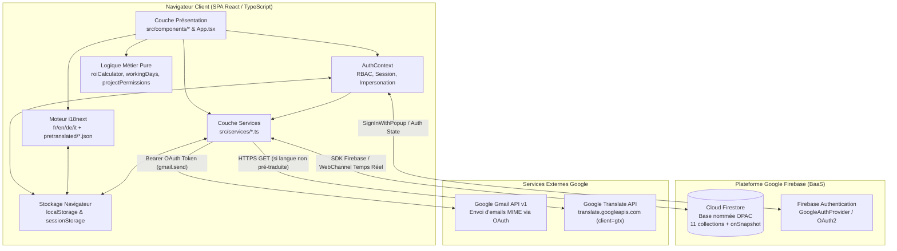
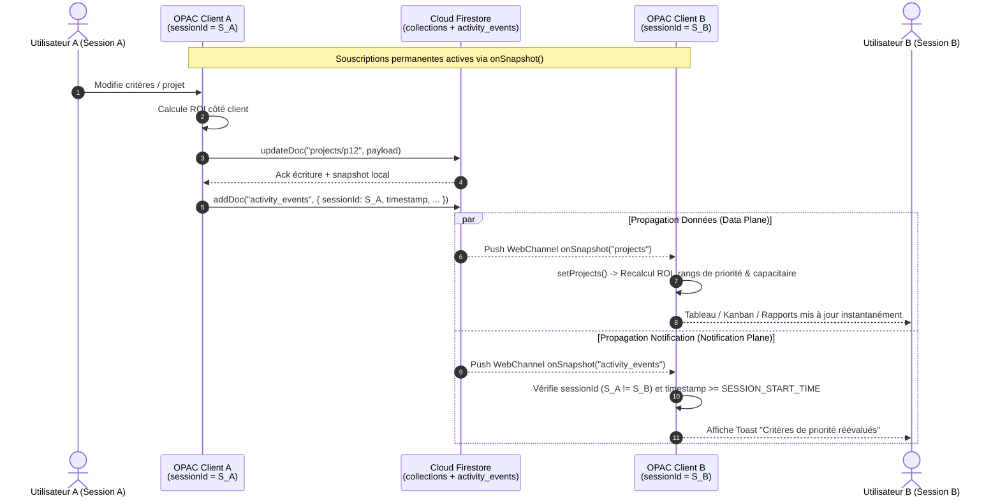
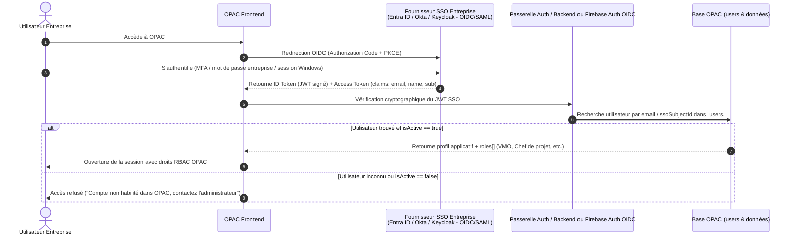
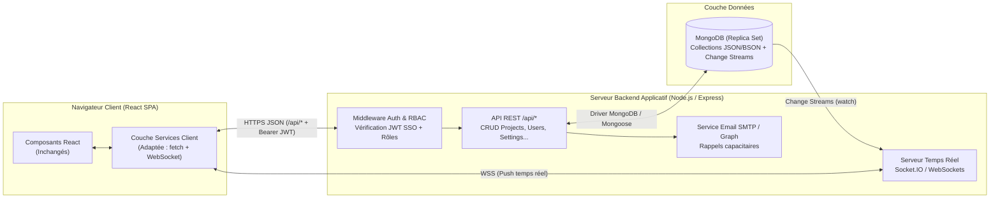

# Dossier d'Architecture Technique et Applicative — OPAC

**Application :** Priorisation Projets & Compétences (`OPAC`)  
**Objet du document :** Dossier d'architecture de la solution telle qu'elle est développée actuellement et guide de préparation à l'intégration / installation dans l'environnement du client utilisateur (SSO, changement de base de données, contraintes réseau et sécurité).  
**Statut :** Document d'état des lieux et de cadrage d'intégration (basé sur l'analyse du code source actuel).

---

## Table des matières

1. [Vue d'ensemble & Architecture logique actuelle](#1-vue-densemble--architecture-logique-actuelle)
2. [Langages utilisés](#2-langages-utilisés)
3. [Stacks techniques et composants sur étagère](#3-stacks-techniques-et-composants-sur-étagère)
4. [Design Patterns et organisation du code](#4-design-patterns-et-organisation-du-code)
5. [Modèle de données actuel (Firestore)](#5-modèle-de-données-actuel-firestore)
6. [Synchronisation temps réel et répercussion multi-utilisateurs](#6-synchronisation-temps-réel-et-répercussion-multi-utilisateurs)
7. [Gestion actuelle des utilisateurs et trajectoire vers un SSO](#7-gestion-actuelle-des-utilisateurs-et-trajectoire-vers-un-sso)
8. [Remplacement de la base de données (ex. MongoDB)](#8-remplacement-de-la-base-de-données-ex-mongodb)
9. [Contraintes techniques et limites de l'architecture actuelle](#9-contraintes-techniques-et-limites-de-larchitecture-actuelle)
10. [Éléments complémentaires pour l'installation chez le client](#10-éléments-complémentaires-pour-linstallation-chez-le-client)

---

## 1. Vue d'ensemble & Architecture logique actuelle

L'application **OPAC** est actuellement conçue selon une architecture **SPA (Single Page Application) Serverless / BaaS (Backend-as-a-Service)** :
- Toute l'interface utilisateur, la logique métier (calcul de ROI, classement de priorité, planification capacitaire sur 12 mois glissants, détection de goulets d'étranglement, droits d'accès RBAC, import/export CSV et sauvegarde JSON) s'exécute **côté navigateur (client-side)**.
- Il n'y a **pas de serveur backend applicatif intermédiaire** en exécution aujourd'hui : le client React dialogue directement via HTTPS/WebChannel avec les services managés **Google Firebase** (Cloud Firestore et Firebase Auth) ainsi qu'avec deux API REST Google externes (Gmail API et Google Translate API).

### Schéma d'architecture globale actuelle



### Arborescence fonctionnelle du projet

```text
/
├── index.html                      # Point d'entrée HTML5 SPA
├── package.json                    # Dépendances et scripts Vite/TypeScript
├── tsconfig.json                   # Configuration TypeScript (ES2022 / ESNext / react-jsx)
├── vite.config.ts                  # Configuration bundler Vite + plugin Tailwind
├── metadata.json                   # Métadonnées applicatives
├── firebase-applet-config.json     # Configuration publique client Firebase + ID base Firestore
├── firebase-blueprint.json         # Schéma JSON documentaire des entités Firestore
├── firestore.rules                 # Règles de sécurité Firestore
└── src/
    ├── main.tsx                    # Bootstrap React + initialisation i18n
    ├── App.tsx                     # Shell applicatif, navigation par onglets, souscriptions globales
    ├── index.css                   # Point d'entrée CSS Tailwind v4
    ├── lib/                        # Initialisation SDK Firebase & normalisation d'erreurs Firestore
    ├── contexts/                   # AuthContext (session, RBAC, mode conception, usurpation)
    ├── constants/                  # Design tokens UI (ui.ts), palettes couleurs, données de seed LPM
    ├── types/                      # Contrats TypeScript métier (Project, User, Criterion, Resource, etc.)
    ├── utils/                      # Calculs purs (ROI, jours ouvrés, permissions, sécurité mot de passe, dates)
    ├── services/                   # Couche d'accès Firestore, CSV, Backup JSON, Gmail, Traduction, Collaboration
    ├── i18n/                       # Configuration i18next, dictionnaires natifs et 13 JSON pré-traduits
    └── components/                 # 46 composants React (tableaux, modales, Kanban, graphes SVG, administration)
```

---

## 2. Langages utilisés

| Langage / DSL | Portée dans le projet | Rôle exact |
| :--- | :--- | :--- |
| **TypeScript (`.ts`)** | `src/services/*`, `src/types/*`, `src/utils/*`, `src/lib/*`, `src/constants/*`, `vite.config.ts` | Langage principal (`target: ES2022`, `module: ESNext`). Typage statique des entités métier, logique algorithmique, services d'accès aux données. |
| **TSX (`.tsx`)** | `src/App.tsx`, `src/main.tsx`, `src/contexts/AuthContext.tsx`, `src/components/*.tsx` | Composants fonctionnels React 19 avec JSX typé (`jsx: react-jsx`). |
| **HTML5** | `index.html`, templates dans `src/services/emailService.ts` | Page hôte de la SPA et génération des corps HTML d'emails transactionnels (encapsulés en MIME Base64). |
| **CSS3 (Tailwind CSS v4)** | `src/index.css`, classes utilitaires dans `src/constants/ui.ts` et composants `.tsx` | Stylisation via `@tailwindcss/vite` (aucun fichier CSS par composant, pas de préprocesseur SASS/LESS). |
| **SVG / Canvas API** | `ProjectsReportsView.tsx`, `ConsolidatedCapacityHistoryCard.tsx`, `ProjectCapacityHistoryModal.tsx`, `Flags.tsx`, `brandingService.ts` | Rendu vectoriel natif des graphiques (matrice Valeur/Coût, histogrammes capacitaires, drapeaux) sans librairie graphique tierce ; redimensionnement d'images côté client via `<canvas>`. |
| **JSON** | `package.json`, `tsconfig.json`, `firebase-*.json`, `src/i18n/pretranslated/*.json` | Configuration, schéma Firestore et dictionnaires de traduction embarqués. |
| **Firestore Rules DSL** | `firestore.rules` | Langage déclaratif de sécurité côté serveur Firebase Firestore. |

---

## 3. Stacks techniques et composants sur étagère

### 3.1 Stack Frontend & Outillage de Build

| Composant | Version (`package.json`) | Rôle |
| :--- | :--- | :--- |
| **React & React DOM** | `^19.0.1` | Framework UI par composants fonctionnels et Hooks (`useState`, `useEffect`, `useMemo`, `useRef`, `useContext`). |
| **TypeScript** | `^7.0.2` | Vérification de types statique (`npm run lint` via `tsc --noEmit`). |
| **Vite** | `^8.3.0` | Serveur de développement (port `3000`) et bundler de production ES Modules (`vite build`). |
| **@vitejs/plugin-react** | `^6.1.1` | Compilation React JSX / Fast Refresh. |
| **Tailwind CSS & `@tailwindcss/vite`** | `^4.3.3` | Framework CSS utility-first intégré directement au pipeline Vite (avec `autoprefixer`). |
| **Lucide React** | `^0.546.0` | Bibliothèque d'icônes SVG vectorielles. |
| **i18next & react-i18next** | `^26.5.7` / `^17.1.5` | Moteur d'internationalisation dynamique (interpolation `{{var}}`, changement de langue à chaud, ajout de ressources en mémoire). |

### 3.2 Composants sur étagère (Services managés et APIs)

| Composant sur étagère | Technologie / Fournisseur | Utilisation dans OPAC |
| :--- | :--- | :--- |
| **Base de données NoSQL temps réel** | **Google Cloud Firestore** (`firebase ^12.19.0`) | Stockage persistant JSON/Documentaire dans une instance nommée (`ai-studio-priorisationproj-1ae64907-a5e0-41bf-b2ec-0d3fcde1bed3`). Synchronisation temps réel via `onSnapshot` et transactions atomiques (`runTransaction`). |
| **Service d'authentification / OAuth** | **Firebase Authentication** (`GoogleAuthProvider`) | Authentification OAuth2 Google par popup (`signInWithPopup`) pour obtenir un jeton d'accès utilisateur (`gmail.send`) et gérer la réinitialisation éventuelle. |
| **Service d'envoi d'emails** | **Google Gmail REST API v1** | Envoi d'emails d'activation, de réinitialisation de mot de passe et de rappels capacitaires directement depuis le navigateur de l'administrateur/utilisateur connecté (`https://gmail.googleapis.com/gmail/v1/users/me/messages/send`). |
| **Service de traduction automatique** | **Google Translate Web Endpoint** | Traduction automatique par lots pour toute nouvelle langue ne disposant pas d'un fichier pré-traduit JSON embarqué (`https://translate.googleapis.com/translate_a/single?client=gtx`). |
| **APIs Natives Navigateur** | **Web Crypto API, FileReader, Blob, Storage** | Hachage SHA-256 (`crypto.subtle`), génération d'UUID (`crypto.randomUUID`), import/export de fichiers CSV (`|`) et JSON, caches `localStorage` et `sessionStorage`. |

### 3.3 Note sur les dépendances présentes dans `package.json` mais non utilisées au runtime

Lors d'un audit du code source (`src/`), les paquets suivants figurent dans `package.json` (héritage du socle template) mais ne sont **importés nulle part** dans l'application active :
- `express`, `@types/express`, `dotenv` (aucun `server.ts` n'est utilisé : `npm run dev` lance uniquement `vite`).
- `motion` (les animations reposent sur les classes CSS/Tailwind `animate-in`, `transition-*`).
- `@google/genai` (aucun appel LLM côté client ou serveur).

> **Recommandation client :** Nettoyer ces dépendances inutilisées (ou réutiliser `express` si un Backend-for-Frontend est mis en place pour MongoDB / SSO / relais SMTP — voir sections 7 et 8).

---

## 4. Design Patterns et organisation du code

L'application suit une structuration modulaire claire malgré l'absence de backend dédié :

1. **Service Layer Pattern (`src/services/*.ts`)**  
   Chaque domaine métier possède son service dédié (`projectService`, `criteriaService`, `budgetService`, `skillService`, `resourceService`, `lifecycleService`, `customParamService`, `userService`, `bonusService`, `brandingService`, `translationService`). Les composants React ne manipulent pas directement `collection(db, ...)` (hormis `backupService.ts` qui agrège toutes les collections pour la sauvegarde/restauration globale).

2. **Observer / Reactive Subscription Pattern (`subscribeTo*`)**  
   Chaque service expose une fonction `subscribeToX(onData, onError)` encapsulant `onSnapshot` Firestore et renvoyant une fonction de nettoyage (`Unsubscribe`). `App.tsx` et `AuthContext.tsx` montent ces écouteurs dans des `useEffect` au démarrage de l'application.

3. **Provider / Context Pattern (`src/contexts/AuthContext.tsx`)**  
   Centralise l'état d'identité (`realUser`, `impersonatedUser`, `activeUser`), le mode conception, le rôle endossé (`assumedRole`) et expose les droits effectifs pré-calculés (`isSuperUser`, `isAdmin`, `isProjectManager`, `isResourceManager`, `isValueManagementOfficer`).

4. **Event-Driven Collaborative Notification Bus (`collaborationNotificationService.ts`)**  
   Découple l'écriture de données métier de la notification des autres utilisateurs : chaque service émet un événement dans `activity_events` via `broadcastCollaborationChange`, taggé par un `CLIENT_SESSION_ID` unique généré à l'ouverture de l'onglet.

5. **Local-Cache-First / Stale-While-Revalidate Pattern**  
   Pour éviter le clignotement visuel au chargement (logo personnalisé dans `brandingService.ts`, paramètres de bonus dans `bonusService.ts`, alertes critères dans `criteriaAlertService.ts`, surcharges i18n dans `translationService.ts`), la dernière valeur connue est lue de manière synchrone depuis `localStorage` avant d'être écrasée par le premier flux `onSnapshot`.

6. **Strategy / Multi-Level Fallback Pattern (Internationalisation)**  
   `autoTranslateService.ts` résout une nouvelle langue selon une chaîne de repli ordonnée :
   1. Chargement instantané depuis le dictionnaire JSON embarqué (`src/i18n/pretranslated/*.json` via `import.meta.glob` dans `pretranslatedStore.ts`).
   2. Sinon, appel réseau par lots de 12 textes à Google Translate avec *backoff exponentiel* sur HTTP 429 et repli unitaire en cas d'erreur de découpage.
   3. Sinon, repli sur le texte source (`fr` ou `en`).

7. **Transaction & Atomic Counter Pattern (`getNextProjectNumber`)**  
   `projectService.ts` utilise `runTransaction` sur le document `counters/projects` afin d'attribuer un `projectNumber` séquentiel unique et jamais réutilisé, même en cas de créations concurrentes ou de suppression d'un projet.

8. **Pure Domain Functions (`src/utils/*.ts`)**  
   Les règles de calcul critiques sont isolées en fonctions pures testables indépendamment de React et de Firestore : `calculateProjectRoi`, `canEditProject`, `canViewConfidentialProject`, `getWorkingDaysInMonth`, `calculateResourceAvailability`, `validatePassword`, `hashPassword`, `normalizePeriodKey`.

9. **Chunked Batch Write Pattern (`backupService.ts`)**  
   L'import/restauration JSON complète et la réinitialisation utilisent `writeBatch(db)` découpé par tranches de **400 opérations** (pour rester sous la limite Firestore de 500 opérations par batch).

---

## 5. Modèle de données actuel (Firestore)

La base Cloud Firestore (`ai-studio-priorisationproj-1ae64907-a5e0-41bf-b2ec-0d3fcde1bed3`) repose sur **11 collections racine** :

| Collection Firestore | Clé / Identifiant | Rôle et contenu principal |
| :--- | :--- | :--- |
| `projects` | Auto-ID Firestore + `projectNumber` unique | Projets : métadonnées, état (`stateId`), chef de projet/adjoint (email), `isConfidential`, ligne budgétaire, budget estimé, `criteriaValues`, `bonus`, `roi`, `customParamValues`, `isStaffed`, capacitaire (`capacityUpdatedMonth`, `capacityDaysPerSkill`, `capacityHistory`, `staffingPlan`, `remainingToComplete`, `staffingPlanValidatedMonths`, `isRatValidated`, `ratValidatedMonth`, `ratHistory`). |
| `users` | Auto-ID Firestore (`email` unique métier) | Annuaire applicatif : `email`, `displayName`, `roles[]` / `role`, `isSuperAdmin`, `isActive`, `preferredLanguage`, `passwordHash`, `mustResetPassword`, jetons `activationToken` / `resetToken` et dates d'expiration. |
| `criteria` | Auto-ID Firestore | Critères de priorisation (`VALEUR` ou `COÛT`), poids (`1, 2, 3, 5, 8, 13`), `isActive`, 6 échelons textuels (`0, 1, 2, 3, 5, 8`), `order`. |
| `budgetLines` | Auto-ID Firestore | Lignes budgétaires (`name`, `budgetKe`, `manager`, `color`, `isActive`, `order`). |
| `keySkills` | Auto-ID Firestore | Compétences clés goulets d'étranglement, `resourceManagerId`, plafond par ligne budgétaire (`isCapped`, `budgetAllocations`, `alertOnDemandOverrun`), `order`. |
| `resources` | Auto-ID Firestore | Ressources humaines/équipes rattachées à une compétence (`skillId`, `fte`, calendrier `unavailability` indexé `YYYY-MM`). |
| `projectStates` | Auto-ID Firestore | États du cycle de vie (`name`, `needsStaffing`, `needsPrioritization`, `order`). |
| `projectCustomParams` | Auto-ID Firestore | Définition des champs personnalisés de projets (`name`, `type`, `options`, `allowMultiple`, `showInTable`, `order`). |
| `counters` | `counters/projects` | Compteur transactionnel `lastProjectNumber` pour les numéros de projets. |
| `settings` | `prioritization_bonus`, `branding`, `criteria_alert_config`, `translations` | Documents de configuration singleton : règles/quotas de bonus, logo base64, seuils d'alerte d'étagement des critères, langues actives et dictionnaire complet des surcharges i18n (`overrides`). |
| `activity_events` | Auto-ID Firestore | Flux d'événements temps réel (`category`, `title`, `message`, `actorEmail`, `actorName`, `projectId`, `sessionId`, `timestamp`) pour les notifications collaboratives entre sessions. |

---

## 6. Synchronisation temps réel et répercussion multi-utilisateurs

Lorsqu'un **Utilisateur A** modifie un projet, réévalue des critères, ajuste un plan de staffing ou change un paramétrage, l'**Utilisateur B** connecté sur un autre poste voit immédiatement le changement **sans rafraîchir sa page**.

Ce comportement repose sur **deux mécanismes complémentaires** :

### 6.1 Mécanisme 1 : Réplication temps réel des données (`onSnapshot`)
- Dès le chargement de l'application (`App.tsx` et `AuthContext.tsx`), chaque instance client ouvre des **souscriptions permanentes WebChannel** sur toutes les collections Firestore (`subscribeToProjects`, `subscribeToCriteria`, `subscribeToBudgetLines`, `subscribeToKeySkills`, `subscribeToResources`, `subscribeToProjectStates`, `subscribeToCustomParams`, `subscribeToUsers`, `subscribeToBonusConfig`, `subscribeToBranding`, `subscribeToCriteriaAlertConfig`, `subscribeToTranslationOverrides`).
- Dès qu'un client appelle `updateDoc` / `addDoc` / `deleteDoc` / `setDoc`, Firestore pousse le delta à toutes les instances abonnées en quelques centaines de millisecondes.
- Le state React local est mis à jour et les sélecteurs `useMemo` recalculent instantanément **dans chaque navigateur** le ROI, le rang de priorité, la charge capacitaire consolidée et les alertes de goulets d'étranglement.

### 6.2 Mécanisme 2 : Notifications collaboratives inter-sessions (`activity_events`)
- Chaque service métier appelle `broadcastCollaborationChange(...)` après une mutation réussie.
- Chaque onglet génère un `CLIENT_SESSION_ID` unique en mémoire au chargement (`crypto.randomUUID()`).
- Toutes les instances écoutent les 15 derniers documents de `activity_events` (`orderBy('timestamp', 'desc'), limit(15)`).
- Les filtres suivants empêchent le bruit et l'auto-notification :
  1. `eventSessionId === CLIENT_SESSION_ID` → ignoré (l'auteur dans son onglet n'est pas notifié).
  2. `eventTimestamp < SESSION_START_TIME - 2000` → ignoré (pas de rejeu d'anciens événements au démarrage).
  3. Déduplication par `doc.id` via un `Set`.
- Si l'événement provient d'une autre session, une notification toast (`CollaborationNotificationToast`) s'affiche en temps réel.

### Diagramme de séquence de la propagation temps réel



### Limite de concurrence actuelle
L'application utilise un modèle **Last-Write-Wins** (dernier écrit gagnant au niveau des champs envoyés dans `updateDoc`) sans verrouillage optimiste (pas de numéro de version `etag` / `version` vérifié à l'écriture). Si deux utilisateurs modifient simultanément le même projet dans deux modales ouvertes en même temps, la seconde sauvegarde écrase silencieusement les champs modifiés par la première.

---

## 7. Gestion actuelle des utilisateurs et trajectoire vers un SSO

### 7.1 Fonctionnement actuel de l'authentification et des rôles

Aujourd'hui, les utilisateurs et leurs droits sont stockés dans la collection Firestore `users` et orchestrés par `AuthContext.tsx`, `userService.ts` et `LoginModal.tsx` :

1. **Identité et création de compte** :
   - Un Administrateur ou Super User crée un utilisateur dans l'onglet *Utilisateurs* avec `email`, `displayName` et un tableau `roles[]` parmi 5 rôles : `'super user'`, `'administrateur'`, `'chef de projet'`, `'resource manager'`, `'value management officer'` (cumul multi-rôles supporté).
   - Le compte est créé avec `isActive: false`, `mustResetPassword: true` et un `activationToken` aléatoire valable 7 jours.
   - Un email HTML est envoyé via l'API Gmail (avec le compte OAuth du Super User) contenant un lien `?action=activate&email=...&token=...` et le code d'activation manuel.
2. **Authentification locale en base** :
   - L'utilisateur définit un mot de passe d'au moins **20 caractères** (majuscule, minuscule, chiffre, caractère spécial — `validatePassword`).
   - Le navigateur calcule une empreinte **SHA-256 salée** (`priorisation_<email>_secure_salt_2026` dans `passwordSecurity.ts`) et l'enregistre dans `users.passwordHash`.
   - À la connexion, `LoginModal` recalcule ce hash SHA-256 côté client et le compare au champ `passwordHash` récupéré via `subscribeToUsers`.
3. **Gestion de session navigateur** :
   - L'email authentifié est mémorisé dans `sessionStorage` (`opac_session_email`).
   - En environnement de développement / sandbox (`isConceptionEnvironment()` : `localhost`, `*.run.app`, `import.meta.env.DEV`), le compte concepteur (`SUPER_ADMIN_EMAIL = 'stephane.labati@goood.com'`) est auto-connecté, sauf déconnexion explicite (`opac_explicit_logout`). En production publiée (`*.ai.studio`), la mire de connexion est imposée.
4. **Contrôle d'accès RBAC & fonctionnalités Super User** :
   - Les permissions UI et fonctionnelles (`canEditProject`, `canViewConfidentialProject`, accès aux onglets *Paramètres*, *Ressources*, *Utilisateurs*) sont calculées dans `AuthContext.tsx` à partir de `effectiveRoles`.
   - Le **Super User** dispose de deux fonctions avancées purement applicatives :
     - **Endossement de rôle (`assumeRole`)** : simuler un rôle spécifique pour vérifier l'ergonomie.
     - **Usurpation d'identité (`impersonateUser`)** : se placer dans la peau d'un autre utilisateur enregistré en conservant en arrière-plan `realUser`.

### 7.2 Remplacement de l'authentification locale par du SSO (avec rôles conservés dans OPAC)

L'objectif cible est : **déléguer l'authentification (qui est l'utilisateur ?) au fournisseur d'identité (IdP) de l'entreprise via SSO (OIDC / OAuth2 ou SAML 2.0)** — ex. Microsoft Entra ID (Azure AD), Okta, Keycloak, Google Workspace — tout en **conservant la gestion fine des rôles et des règles métier dans l'application OPAC**.

#### Architecture cible recommandée (Séparation AuthN / AuthZ)



#### Deux options d'implémentation selon le contexte d'hébergement client

| Option | Cas d'usage | Impact sur le code actuel |
| :--- | :--- | :--- |
| **Option A : SSO via Firebase Auth (`OAuthProvider` OIDC / `SAMLAuthProvider`)** | L'application reste hébergée sur Firebase/Cloud Run avec Firestore. | Très faible : remplacer `signInWithPopup(auth, googleProvider)` et le formulaire mot de passe de `LoginModal.tsx` par `signInWithRedirect` / `signInWithPopup` sur un `OAuthProvider('oidc.entreprise')` ou `SAMLAuthProvider('saml.entreprise')`. Firestore Rules peut alors exiger `request.auth != null` ! |
| **Option B : OIDC / SAML pur côté client ou BFF (`oidc-client-ts`, `@azure/msal-browser`, ou Backend Express)** | L'application est hébergée *on-premise* ou dans un cloud client (avec ou sans MongoDB). | Moyen : `AuthContext` écoute le jeton OIDC validé (ou l'endpoint `/api/me` d'un BFF qui porte la session cookie `HttpOnly`), extrait l'`email` vérifié du claim JWT, puis charge le document `users` correspondant pour récupérer `roles[]`. |

#### Impacts précis sur le code source d'OPAC pour passer au SSO

1. **Suppression des mécanismes de mots de passe locaux** :
   - Retirer `passwordHash`, `mustResetPassword`, `activationToken`, `resetToken` de `AppUser` (`src/types/user.ts`) et de `userService.ts`.
   - Supprimer `src/utils/passwordSecurity.ts` (SHA-256 client).
   - Simplifier `LoginModal.tsx` : supprimer les écrans *mot de passe oublié*, *code d'activation*, *changement de mot de passe*, pour ne garder qu'un bouton **"Se connecter avec le SSO entreprise"** (ou déclenchement automatique au chargement).
   - Supprimer les fonctionnalités de réinitialisation / envoi de lien d'activation dans `UserManagement.tsx` et `UserProfileModal.tsx`.
2. **Conservation et renforcement du modèle RBAC dans `users`** :
   - Lors de la création d'un utilisateur par l'Administrateur dans `UserManagement.tsx`, celui-ci saisit uniquement `email` (identifiant de rapprochement SSO — voire `ssoSubjectId` / `oid` pour résister aux changements d'adresse email suite à mariage/changement de nom), `displayName` et `roles[]`, avec `isActive: true` par défaut.
   - Ajouter un paramètre configurable (variable d'environnement ou document `settings`) pour désigner le ou les comptes `Super User` initiaux au lieu de l'adresse codée en dur `stephane.labati@goood.com`.
   - Option d'onboarding : soit **whitelist stricte** (seuls les utilisateurs pré-créés dans `users` accèdent à l'app), soit **Just-In-Time (JIT) Provisioning** (tout utilisateur SSO valide obtient automatiquement un compte avec un rôle minimal en lecture ou `chef de projet` selon la politique DSI).
3. **Gestion de la déconnexion, du mode conception et de l'usurpation** :
   - Supprimer le contournement automatique `isConceptionEnvironment()` en production client (ne l'autoriser que sur flag explicite de build local).
   - L'usurpation (`impersonateUser`) reste possible côté applicatif pour le support `Super User`, mais doit être **journalisée dans un log d'audit immuable** côté serveur si la politique de sécurité du client l'exige (ou désactivée en production).

---

## 8. Remplacement de la base de données (ex. MongoDB)

### 8.1 Pourquoi un tiers Backend est indispensable pour MongoDB (ou SQL)

Firestore permet aujourd'hui au navigateur de se connecter directement à la base grâce à une API HTTP/WebChannel conçue pour les navigateurs et gouvernée par des règles d'accès (`firestore.rules`).

À l'inverse, **une base comme MongoDB (ou PostgreSQL) ne doit et ne peut pas être exposée directement au navigateur** :
- Le protocole binaire MongoDB (TCP/27017) ne fonctionne pas nativement depuis un navigateur Web.
- Exposer une chaîne de connexion ou des identifiants MongoDB dans le bundle JavaScript client reviendrait à donner un accès administrateur total à la base à n'importe quel utilisateur.

**Conséquence architecturale :** Remplacer Firestore par MongoDB impose d'introduire un **Backend API (Node.js / Express, Fastify ou NestJS)** entre la SPA React et MongoDB, ainsi qu'un canal temps réel (WebSockets / SSE).

### 8.2 Architecture cible avec Backend Node.js + MongoDB



### 8.3 Plan de migration détaillé vers MongoDB

1. **Conservation intégrale de l'UI et de la logique métier** :
   - Aucun des 46 composants React (`src/components/*`), ni des utilitaires (`roiCalculator.ts`, `workingDays.ts`, `projectPermissions.ts`) n'a besoin d'être réécrit fonctionnellement, **à condition de conserver exactement les interfaces exportées par `src/services/*.ts` et `src/types/*.ts`**.
2. **Mapping des données Firestore → MongoDB** :
   - La transition structurelle est particulièrement fluide car Firestore et MongoDB sont tous deux des bases orientées documents JSON/BSON.
   - Les objets imbriqués de `Project` (`criteriaValues`, `customParamValues`, `capacityDaysPerSkill`, `capacityHistory`, `staffingPlan`, `remainingToComplete`, `staffingPlanValidatedMonths`, `ratHistory`) et de `Resource` (`unavailability`) se mappent **à l'identique** en sous-documents BSON MongoDB.
   - Les `_id` (`ObjectId` ou UUID `string` stocké dans `_id`) sont convertis en propriété `id: string` dans les sérialiseurs de l'API pour rester transparents pour le frontend.
   - **Compteurs séquentiels (`counters/projects`)** : remplacer la transaction Firestore `getNextProjectNumber()` par une opération atomique native MongoDB :
     ```js
     db.collection('counters').findOneAndUpdate(
       { _id: 'projects' },
       { $inc: { lastProjectNumber: 1 }, $set: { updatedAt: new Date() } },
       { upsert: true, returnDocument: 'after' }
     );
     ```
   - **Index MongoDB à créer** :
     - `users`: index unique `{ email: 1 }`.
     - `projects`: index unique `{ projectNumber: 1 }` + index `{ stateId: 1, budgetLineId: 1 }`.
     - `activity_events`: index `{ timestamp: -1 }` + **index TTL** (`expireAfterSeconds: 86400`) pour purger automatiquement les anciennes notifications collaboratives.
3. **Remplacement du temps réel (`onSnapshot`)** :
   - **Approche recommandée (MongoDB Replica Set)** : le backend écoute les **MongoDB Change Streams** (`collection.watch()`) et diffuse les mises à jour aux clients connectés via **Socket.IO / WebSockets** (ou via des salles/événements par collection : `projects:changed`, `criteria:changed`, `activity_events:added`).
   - **Approche simplifiée (si MongoDB standalone sans Replica Set)** : chaque route REST `POST/PATCH/DELETE` du backend émet l'événement WebSocket aux clients connectés juste après confirmation d'écriture en base.
   - Côté frontend, remplacer l'appel `onSnapshot(...)` dans chaque `subscribeTo*` par l'enregistrement d'un listener sur le client WebSocket partagé + un chargement initial `fetch('/api/...')`.
4. **Reprise des données existantes** :
   - L'application dispose déjà d'un export complet au format JSON (`OPAC_BACKUP` via `backupService.ts`), qui sérialise les 10 collections principales et les `Timestamp` en chaînes ISO.
   - Un script d'import Node.js peut ingérer directement ce fichier JSON dans MongoDB en préservant les identifiants `id` initiaux pour ne casser aucune référence étrangère (`stateId`, `budgetLineId`, `skillId`, clés de `criteriaValues`, etc.).

---

## 9. Contraintes techniques et limites de l'architecture actuelle

Voici l'inventaire exhaustif des contraintes observées dans le code actuel, critiques à anticiper avant une mise en production client :

### 9.1 Dépendance à Google Traduction pour l'ajout de nouvelles langues
- **Constat dans le code (`src/services/autoTranslateService.ts` & `pretranslatedStore.ts`)** :
  - L'application embarque **4 langues natives** (`fr`, `en`, `it`, `de`) et **13 dictionnaires pré-traduits statiques** (`src/i18n/pretranslated/*.json` : `ar`, `cs`, `da`, `el`, `es`, `fi`, `hu`, `ko`, `no`, `pt-BR`, `ro`, `sv`, `uk`).
  - Sur les **24 langues du catalogue** (`AVAILABLE_LANGUAGES_CATALOG` dans `src/i18n/languages.ts`), **7 langues n'ont aucun JSON pré-traduit** (`pt`, `nl`, `pl`, `ru`, `zh`, `ja`, `tr`), de même que toute nouvelle langue personnalisée ou tout libellé ajouté après coup.
  - Dans ce cas, `translateAllKeys()` effectue des appels HTTP GET directs depuis le navigateur vers l'endpoint **non officiel** `https://translate.googleapis.com/translate_a/single?client=gtx`.
- **Contraintes induites chez le client** :
  1. **Accès Internet obligatoire** du poste client vers `translate.googleapis.com` (impossible en réseau isolé / intranet fermé / proxy restrictif).
  2. **Endpoint sans contrat ni SLA** : sujet à des blocages IP ou limitations de débit (**HTTP 429**), ce qui explique le regroupement par lots de 12 avec pause de 120 ms et backoff dans le code.
  3. **Risque d'échec CORS ou de blocage pare-feu / DLP** d'entreprise.
  4. En cas d'indisponibilité, l'utilisateur doit basculer sur le texte source (`fr`/`en`) et traduire manuellement dans l'onglet Internationalisation.
- **Remédiation recommandée** : pré-générer les JSON manquants lors du build CI/CD, ou exposer un endpoint backend relayant vers une API officielle sous clé d'entreprise (Google Cloud Translation API v3 ou DeepL API).

### 9.2 Dépendance à Gmail API OAuth côté navigateur pour l'envoi d'emails
- **Constat (`src/services/emailService.ts`, `src/lib/firebase.ts`)** :
  - L'envoi d'emails (activation de compte, réinitialisation mot de passe, relances de chefs de projet) requiert une popup OAuth Google demandant le scope sensible `https://www.googleapis.com/auth/gmail.send`.
  - Le jeton OAuth est conservé uniquement en variable mémoire (`cachedGoogleAccessToken`) : **à chaque rechargement de page (F5), l'utilisateur doit revalider la popup OAuth**.
  - L'expéditeur affiché dans les en-têtes MIME est codé en dur sur `SUPER_ADMIN_EMAIL` (`stephane.labati@goood.com` / `Stéphane Labati (OPAC)`).
- **Contraintes induites chez le client** :
  - Inutilisable si le client n'utilise pas Google Workspace (ex. client sous Microsoft 365 / Exchange), si les administrateurs Workspace bloquent l'application OAuth tierce non approuvée, ou si les navigateurs bloquent les popups.
- **Remédiation recommandée** : déléguer l'envoi d'emails à un service backend connecté au relais SMTP interne ou à l'API Microsoft Graph / SendGrid du client.

### 9.3 Sécurité : Contrôle d'accès actuellement « Client-Side Only »
- **Constat critique (`firestore.rules` et `AuthContext.tsx`)** :
  - Actuellement, `firestore.rules` contient `allow read, write: if true;` sur les collections applicatives (`users`, `projects`, `criteria`, `settings`, etc.).
  - L'application repose sur une authentification personnalisée dans la collection `users` plutôt que sur un jeton Firebase Auth systématique : **Firestore ne vérifie donc pas l'identité ni le rôle de l'appelant côté serveur**.
  - Toute la sécurité RBAC (droits d'édition, accès Super User, **masquage des projets confidentiels** via `canViewConfidentialProject`) est appliquée uniquement dans l'interface React. Un utilisateur inspectant les requêtes réseau ou utilisant les clés publiques de `firebase-applet-config.json` pourrait lire toutes les collections (y compris les `passwordHash` des utilisateurs et les projets confidentiels) ou écrire directement en base.
  - Le hachage de mot de passe (`SHA-256` avec sel fixe prévisible côté navigateur dans `passwordSecurity.ts`) ne respecte pas les standards serveur (Argon2id / bcrypt).
  - La fonction `isConceptionEnvironment()` auto-connecte le compte Super User sans mot de passe dès que l'hôte est `localhost`, `*.run.app` ou un build de développement.
- **Remédiation impérative avant mise en production client** :
  - Activer une véritable authentification vérifiée côté serveur (Firebase Auth OIDC/SAML avec `firestore.rules` strictes, **ou** migration vers Backend API + JWT SSO).
  - Ne jamais exposer `passwordHash` ni les données des projets confidentiels aux clients non autorisés (filtrage côté serveur / rules).
  - Externaliser l'email du Super Admin initial dans une configuration d'environnement (ne plus coder en dur `stephane.labati@goood.com`).

### 9.4 Contraintes de volumétrie, de stockage et de concurrence
- **Chargement intégral en mémoire client** : `subscribeToProjects` et les autres services chargent **100 % des documents** de chaque collection dans le navigateur sans pagination ni filtrage côté serveur. Au-delà de quelques milliers de projets (chacun enrichi de 12+ mois de `capacityHistory`, `staffingPlan` et `ratHistory`), le temps de démarrage, la consommation RAM du navigateur et la bande passante Firestore augmenteront sensiblement.
- **Risque sur la taille limite d'un document Firestore (1 Mo)** :
  - `settings/translations` stocke l'ensemble des surcharges de toutes les langues ajoutées dans **un seul document** (`overrides: { lang: { key: val } }`). Avec ~1 158 clés par langue, l'ajout d'une dizaine de langues personnalisées finira par approcher la limite de 1 Mo de Firestore. Il conviendrait de découper en sous-documents `settings_translations/{langCode}`.
  - `settings/branding` stocke le logo personnalisé directement en Base64 Data URL dans Firestore (atténué par le redimensionnement à 256×256 px).
- **Croissance non bornée de `activity_events`** : chaque action crée un document dans `activity_events` sans mécanisme de purge automatique côté serveur (bien que seuls les 15 derniers soient lus).
- **Concurrence sans verrou** : modèle *Last-Write-Wins* sans gestion de version de document (pas de détection de conflit d'édition simultanée).

---

## 10. Éléments complémentaires pour l'installation chez le client

Pour mener à bien l'installation et l'exploitation en environnement client (DSI / RSSI / équipe Ops), un dossier d'architecture complet doit également inclure les volets suivants :

### 10.1 Matrice des flux réseau et règles pare-feu (Architecture actuelle vs Cible)

| Flux | Origine | Destination | Protocole / Port | Obligatoire ? | Remarque |
| :--- | :--- | :--- | :--- | :--- | :--- |
| Accès application Web | Poste utilisateur | Serveur Web / CDN / Reverse Proxy | HTTPS (443) | Oui | Sert le bundle statique `dist/` (ou proxy vers conteneur). |
| Base de données (actuel) | Poste utilisateur | `firestore.googleapis.com`, `*.firebaseio.com` | HTTPS / WebChannel (443) | Oui (actuel) | Supprimé si migration derrière un Backend API interne. |
| Auth Google / Gmail (actuel) | Poste utilisateur | `identitytoolkit.googleapis.com`, `accounts.google.com`, `gmail.googleapis.com` | HTTPS (443) | Optionnel si SSO/SMTP | Requis uniquement tant que Firebase Google Auth & Gmail API sont utilisés. |
| Traduction dynamique | Poste utilisateur | `translate.googleapis.com` | HTTPS (443) | Optionnel | Uniquement pour ajouter des langues absentes de `pretranslated/*.json`. |
| SSO Entreprise (cible) | Poste & Backend | IdP client (Entra ID, Okta, Keycloak...) | HTTPS (443) | Oui (cible) | OIDC/SAML. |

### 10.2 Stratégie de packaging, hébergement et CI/CD
- **Architecture actuelle (Statique)** : `npm ci && npm run build` génère un dossier `dist/` purement statique déployable derrière n'importe quel serveur Web (Nginx, Apache, Caddy, S3+CloudFront, Azure Static Web Apps, Firebase Hosting). Attention aux règles de routage SPA et aux en-têtes HTTP de sécurité (`Content-Security-Policy`, `HSTS`, `X-Frame-Options`, `X-Content-Type-Options`).
- **Architecture cible (avec Backend + MongoDB)** : conteneurisation Docker (`Dockerfile` multi-stage Node.js + Nginx) orchestrable via Docker Compose ou Kubernetes (avec sondes `/healthz`, `/readyz`), et variables d'environnement injectées au déploiement.

### 10.3 Gestion de la configuration par environnement
Externaliser impérativement les paramètres aujourd'hui codés en dur :
- Identité du compte `Super User` bootstrap (aujourd'hui `stephane.labati@goood.com`).
- Paramètres SSO (`OIDC_ISSUER`, `OIDC_CLIENT_ID`, `OIDC_REDIRECT_URI`).
- Chaînes de connexion base de données (`MONGODB_URI` côté serveur uniquement) et relais SMTP (`SMTP_HOST`, `SMTP_PORT`, `SMTP_FROM`).
- Désactivation stricte de tout mode d'auto-login développement en production (`VITE_ENABLE_CONCEPTION_MODE=false`).

### 10.4 Stratégie de sauvegarde, PRA / PCA et cycle de vie des données
- **Sauvegarde applicative existante** : export global `OPAC_BACKUP` JSON (via le menu Super User) + export/import CSV métier par projets (incluant 12 mois d'historique, 12 mois de staffing et RAT).
- **Sauvegarde infrastructure (en cible client)** : sauvegardes automatisées et chiffrées de la base de données (PITR / snapshots quotidiens MongoDB ou exports managés Firestore) avec test périodique de restauration, RPO/RTO définis avec le métier.
- **Politique de rétention** : purge automatique (TTL) des événements `activity_events` (> 24h) et archivage/glissement des données capacitaires (> 12 mois déjà filtré à l'import CSV).

### 10.5 Observabilité, Journalisation et Piste d'Audit (Audit Trail)
- Aujourd'hui, les erreurs ne sont tracées que dans la console navigateur (`console.error` / `firestoreErrors.ts`) et `activity_events` ne sert qu'aux toasts temps réel sans garantie de rétention.
- **À prévoir chez le client** :
  - Journalisation structurée (JSON) des événements de sécurité côté serveur : connexions SSO réussies/échouées, usurpations d'identité (`impersonateUser`), modifications de rôles, suppressions/imports massifs, consultation de projets confidentiels.
  - Collecte applicative (ex. Sentry / OpenTelemetry / ELK / Datadog) pour diagnostiquer les erreurs frontend/backend.

### 10.6 Feuille de route de durcissement recommandée avant mise en production client

| Priorité | Chantier | Description synthétique |
| :---: | :--- | :--- |
| **P0 (Bloquant DSI/RSSI)** | Sécurisation Auth & Données | Remplacer l'auth locale SHA-256 par le SSO client + verrouiller l'accès base côté serveur (Firestore Rules authentifiées ou API Backend + JWT) pour protéger les projets confidentiels et les données utilisateurs. |
| **P0 (Bloquant DSI/RSSI)** | Externalisation Super Admin | Supprimer les adresses email et modes auto-login développeur codés en dur (`SUPER_ADMIN_EMAIL`, `isConceptionEnvironment`). |
| **P1 (Exploitation)** | Relais Email d'entreprise | Remplacer `gmail.send` OAuth client par un envoi SMTP / API interne côté serveur. |
| **P1 (Exploitation)** | Traduction sans accès Google direct | Compléter les JSON pré-traduits (`pt`, `nl`, `pl`, `ru`, `zh`, `ja`, `tr`) ou passer par un proxy serveur vers une API de traduction agréée. |
| **P1 (Exploitation)** | Découpage `settings/translations` & TTL `activity_events` | Éviter le dépassement 1 Mo sur les traductions et éviter la croissance infinie de `activity_events`. |
| **P2 (Scalabilité)** | Migration Base & Pagination | Si choix de MongoDB (ou forte volumétrie > 5 000 projets), introduire le Backend Node.js + WebSockets et paginer/filtrer côté serveur. |
